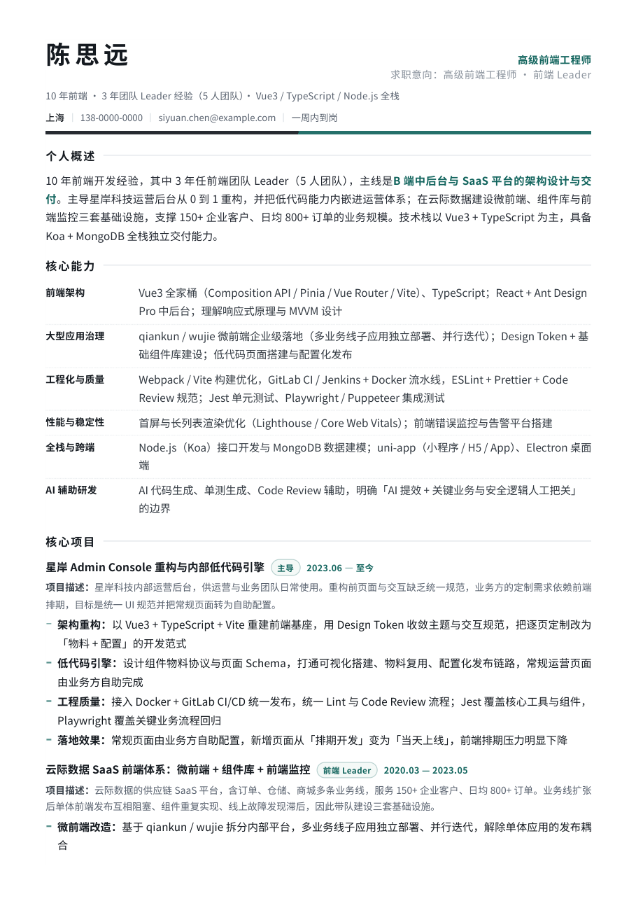
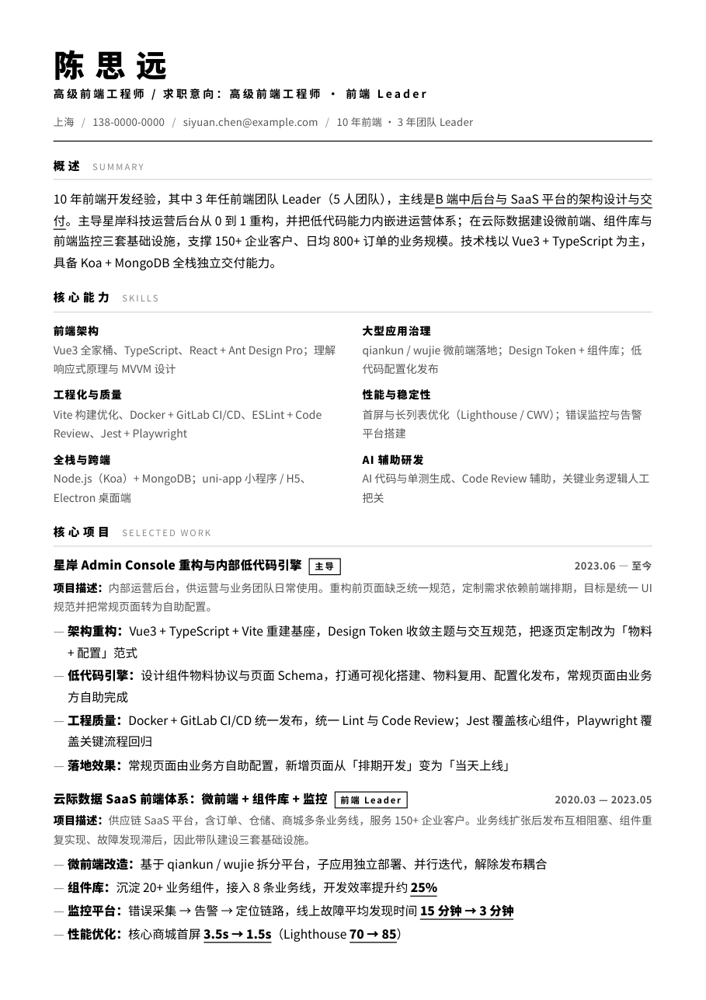
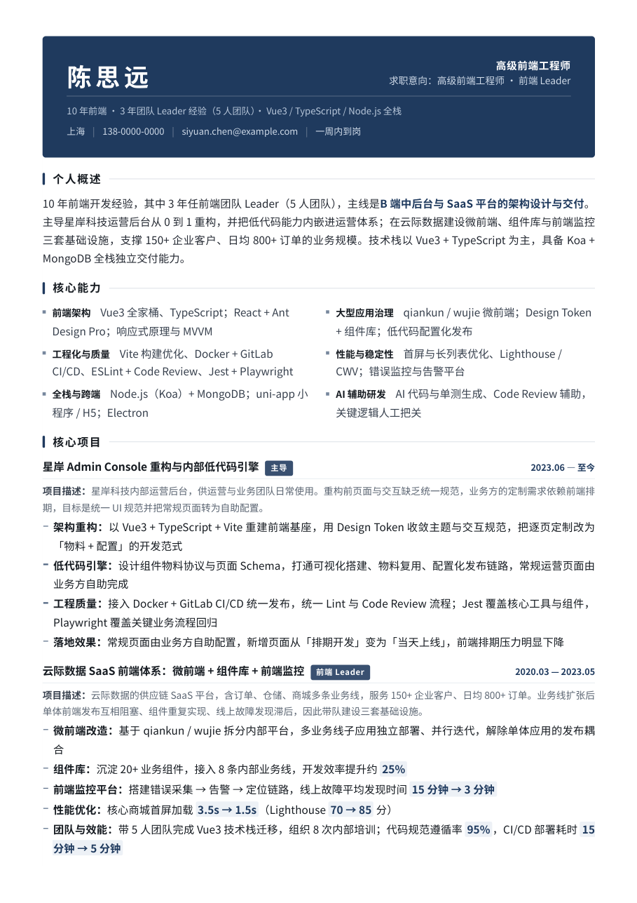
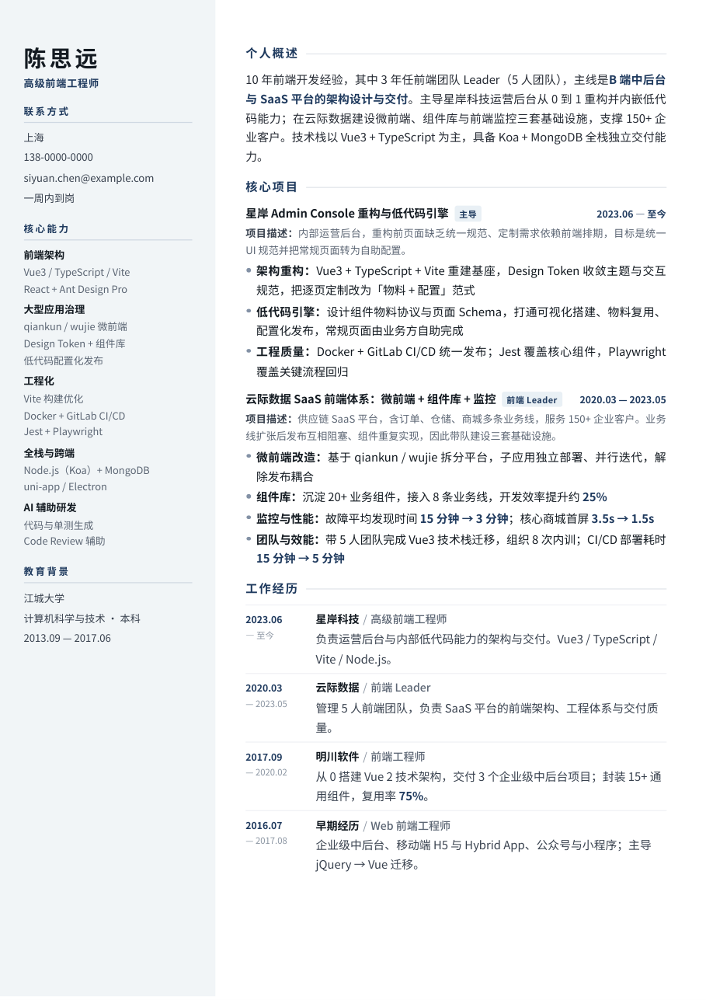

# Resume Forge · 中文简历 A4 模板

四套开箱即用的中文技术简历模板，纯 HTML + CSS，**不需要任何构建工具**：改文字 → 浏览器打印 → 存成 PDF。
每一份都按 A4 排版、验过页数与断页，样例 PDF 在 [`samples/`](samples)。

> 模板里的姓名、公司、数据全部是虚构示例（陈思远 / 星岸科技 / 云际数据），直接替换成你自己的即可。

## 预览

| 模板 | 风格 | 页数 | 适合 |
|---|---|---|---|
| **[classic](templates/classic/index.html)** | 单栏 · 深松石绿 | 2 页 | 5~15 年技术岗，通用投递，最稳 |
| **[mono](templates/mono/index.html)** | 黑白极简 · 无彩色 | 2 页 | 黑白打印、外企、设计感团队 |
| **[navy](templates/navy/index.html)** | 藏青页眉色块 · 双栏技能 | 2 页 | 大厂 / 管理岗 / 想让简历"重"一点 |
| **[sidebar](templates/sidebar/index.html)** | 左信息栏 · 双栏 | 1 页 | 3~8 年经验，一页交代完 |

<p>
  
  
  
  
</p>

第二页（含断页效果）预览：[classic-p2](previews/classic-p2.png) · [mono-p2](previews/mono-p2.png) · [navy-p2](previews/navy-p2.png)

## 快速开始

**方式一：浏览器（零依赖）**

1. 下载或克隆本仓库，把 `templates/classic/index.html` 复制成你自己的文件，比如 `我的简历.html`。
2. 用编辑器打开，把 `<body>` 里的文字换成你的内容（**不要改 class 名和 `<style>` 结构**）。
3. Chrome 打开它 → `Ctrl/Cmd + P` → 目标打印机选「另存为 PDF」→ 边距「默认」→ 勾选「背景图形」→ 缩放 100% → 保存。

**方式二：命令行（推荐，输出稳定可复现）**

```bash
bash scripts/export_pdf.sh templates/classic/index.html 我的简历.pdf
python scripts/check_pdf.py 我的简历.pdf --expect 2 --render
```

`export_pdf.sh` 用 Chrome headless 导出，自动处理了 Windows 上「中文输出路径失败」和「页眉页脚混进 PDF」两个坑。
`check_pdf.py` 会打印每页填充率、首末行文本，并渲染 `preview_p*.png` 供你目检断页。

## 目录结构

```
templates/{classic,mono,navy,sidebar}/index.html   四份独立模板，单文件、无外部依赖
samples/*.pdf                                      每份模板导出的完整样例
previews/*.png                                     README 用预览图
scripts/export_pdf.sh                              Chrome headless 导出
scripts/check_pdf.py                               页数 / 填充率 / 关键词 / 预览图
docs/使用指南.md                                    改内容、调密度、修页数、换配色、打印设置
```

## 排版上做了哪些取舍

- **项目在前、经历在后**：招聘方先看"做过什么量级的事"，再看"在哪家公司"。工作经历退化成诚实的时间轴，指标不再重复两遍。
- **单一强调色 + 字重分层**：一份简历只允许一个主色，层级靠字重、灰阶和细线表达，不靠多色。
- **流式分页，不写死页容器**：`@page` 管边距，正文自然流淌，项目块 `break-inside:auto` 让页底不留空，单条 bullet 不允许被劈开。
- **无装饰**：没有进度条、雷达图、彩色分区、图标堆砌，也没有"性格开朗、抗压能力强"。

四条写作规则（头条 bullet 怎么写、数字怎么用、哪些内容不该出现在简历里）见 [`docs/使用指南.md`](docs/使用指南.md#三内容怎么写)。

## 常见问题

| 现象 | 原因 | 解决 |
|---|---|---|
| 导出成 3 页，第 3 页只有几行 | 字号/行高偏大，或边距被叠加 | 调小 `--base-pt` 或 `--lh`，见指南「控制页数」 |
| 第 1 页底部大片空白 | 某个项目被整块推到下一页 | 把 `.item` 的 `break-inside` 改回 `auto` |
| 色块 / 左侧栏打印不出来 | 打印没勾选「背景图形」 | 勾选 `Background graphics` |
| 导出报「拒绝访问 (0x5)」 | Chrome 不接受中文输出路径 | 用 `scripts/export_pdf.sh`，或先输出 `out.pdf` 再改名 |
| 每页顶部有 `file:///...` 和页码 | 没关页眉页脚 | 加 `--no-pdf-header-footer` |
| 换了电脑字体变形、页数变了 | 中文fallback 字体不同 | 装 [Noto Sans SC](https://fonts.google.com/noto/specimen/Noto+Sans+SC)，或接受微软雅黑/PingFang 的字宽差异 |

## English

Four A4 resume templates for Chinese-language job hunting, in plain HTML+CSS with no build step.
Edit the text in `templates/<name>/index.html`, print to PDF from Chrome (margins: default, background graphics: on), or run
`bash scripts/export_pdf.sh <in.html> <out.pdf>`. Sample persona data is fictional. MIT licensed.

## License

[MIT](LICENSE)。模板可自由商用、修改、二次分发，无需署名。
